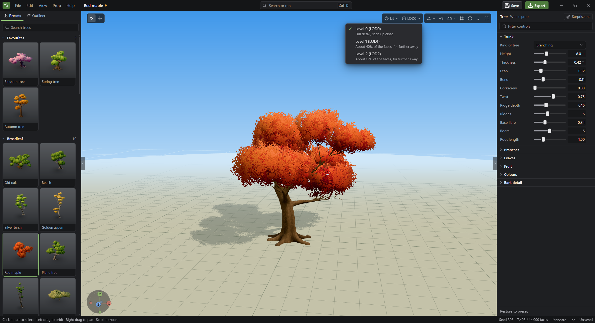
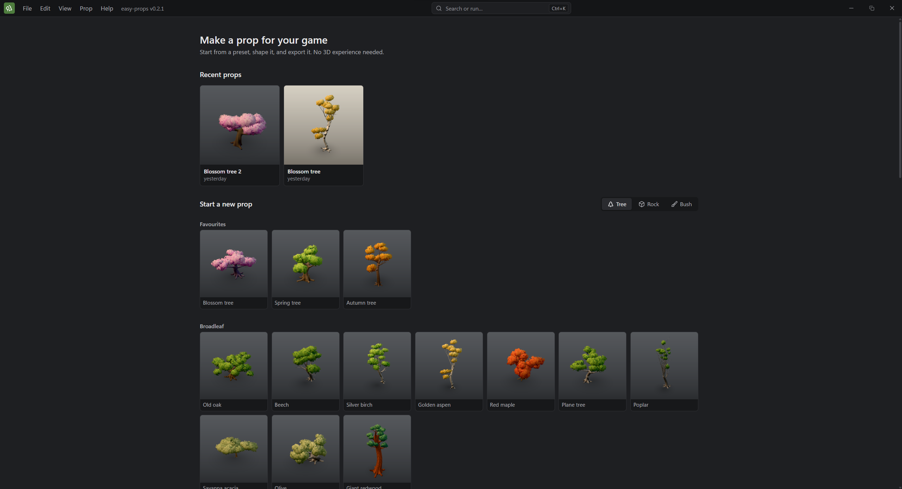
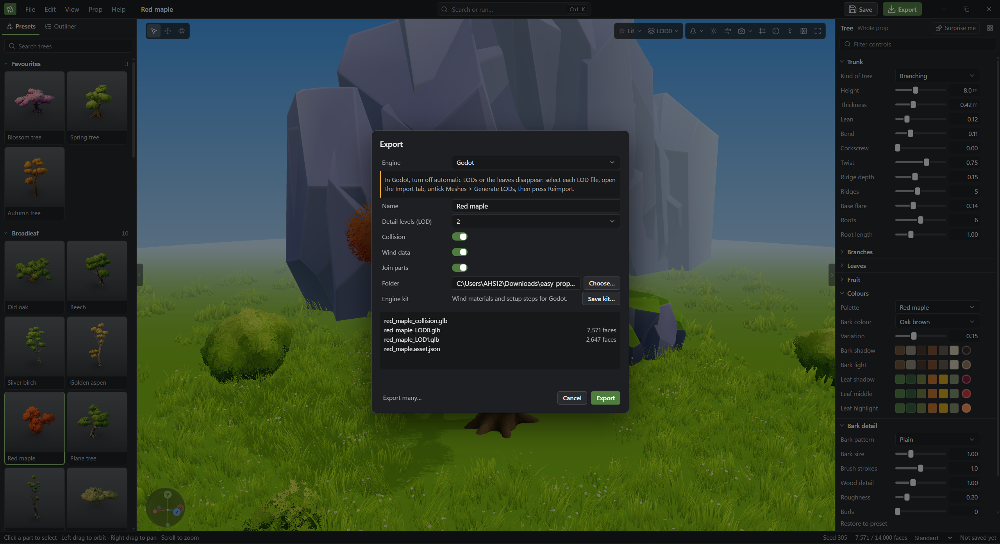

# easy-props

Make game-ready 3D props in minutes, with no 3D experience needed.

Pick a tree, rock, bush, fern or patch of grass, shape it with plain sliders, and
export it for your game engine. It's a focused desktop tool for props, not a
replacement for Blender.



## What it does

- **Start from a preset:** broadleaf trees, palms, conifers, fantasy trees, bushes,
  ferns, grass and flowers, boulders, stones and cliffs.
- **Make it yours:** drag a slider or type a value, and the prop updates live. Click a
  branch or a leaf clump to change just that part, and undo anything.
- **Export for games:** each prop comes as GLB files with detail levels (LOD) and simple
  collision shapes, checked against a face budget.
- **Wind built in:** trees and plants carry wind data in their second UV set, slow sway
  and fast flutter, so they can move in your engine at almost no cost.
- **Engine kits:** **Save kit…** in Export writes what your engine needs for that wind:
  ready-made shaders for Godot, and step-by-step material instructions for Unreal.
- **Export many at once:** batch-export presets, saved props and random variations.



## Using props in your engine



| Target | How |
|---|---|
| Unreal | Choose **Engine: Unreal** in Export and save the kit, then follow the [Unreal guide](docs/unreal-trees.md) |
| Godot | Choose **Engine: Godot** in Export and save the kit, then follow the [Godot guide](docs/godot-trees.md) |
| Blender and other tools | Choose **Plain GLB** in Export |

## Install

Download the Windows installer or Mac DMG from
[Releases](https://github.com/AHS12/easy-props/releases).

The builds aren't signed yet, so the first launch shows a warning:

- **Windows:** choose **More info > Run anyway**.
- **Mac:** drag the app to Applications and try to open it, then choose
  **System Settings > Privacy & Security > Open Anyway**.

## Build from source

You need Go, Node.js, pnpm, [golangci-lint](https://golangci-lint.run/) and the
[Wails CLI](https://wails.io). `wails doctor` should report success. On Windows, `choco install make` provides `make`, and it also needs Git
for Windows in its default folder.

```bash
make install    # Install frontend packages and git hooks, first time only
make dev        # Run the app with hot reload
make build      # Build the app into build/bin
make test       # Run the Go and frontend tests
make lint       # Run every lint, needs golangci-lint
make check      # Run every lint, test and build check
make release    # Build whichever installer this computer can make
```

`make installer` builds the Windows installer (needs NSIS), and `make dmg` builds the
Mac disk image (needs a Mac). Both go to `build/dist`. Run `make` to list every task.

## Releasing

Set the version in `wails.json` and in `APP_VERSION` in
`frontend/src/core/export/export-preferences.ts`, then push. There are two ways to
release, and both build the installers on GitHub and attach them to the release:

- **Automatic:** publish a GitHub Release tagged `vX.Y.Z`.
- **Manual:** run the **Release Installers** workflow under Actions, and enter the tag
  and platform. It creates the release from the chosen branch if it doesn't exist yet,
  and otherwise rebuilds it and replaces its installers. This also gets you a DMG
  without a Mac.

The tag has to match the version, or the run stops before building anything.

## How it's built

Wails (Go) for the desktop shell, React and TypeScript for the interface, and Three.js
for the 3D view. Go only handles files and native dialogs: geometry, editing and export
all live in TypeScript under `frontend/src`.
