# 08 — Rocks, bushes and grass

Status: rocks and the Meadow backdrop are built (stages 0 and 1, see "Built: rocks"). Grass,
bushes and flowers are still a plan. Images named `proto-` came from throwaway browser code.

## The short version

Trees worked because we started from a reference and worked out which maths produces
that look. Rocks and bushes skipped that step. A rock is a smooth blob with cuts that
barely show, a bush is a tree crown lowered towards the ground, and grass is a palm with
short fronds.

Each one needs its own way of being built:

| Asset | Today | Proposed | Tested? |
|---|---|---|---|
| Rock | One distance field, sculpted on a grid | Several exact solids cut by planes, then overlapped | Yes, and the look is right. Cliff layout still needs work |
| Bush | Painted tree generator with fewer branches | A dome shape, a solid core and leaf cards laid over it | Mostly. Two known problems remain |
| Grass | Palm generator with blade fronds | Hundreds of curved blades grouped in clumps | Yes. This was the closest match to the reference |

Our first rock prototype took 22,514 triangles. The method proposed here took 522 for a
similar boulder and looked better. That is the most important result in this document.

## Built: rocks

| | | |
|---|---|---|
| 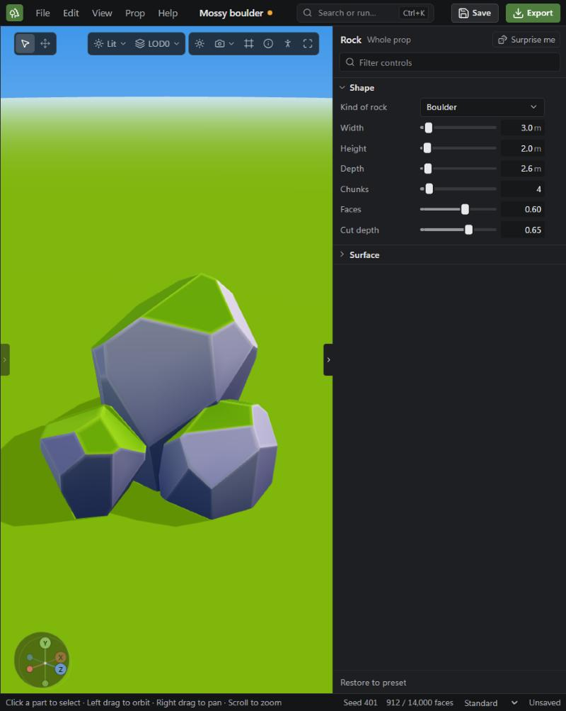 | 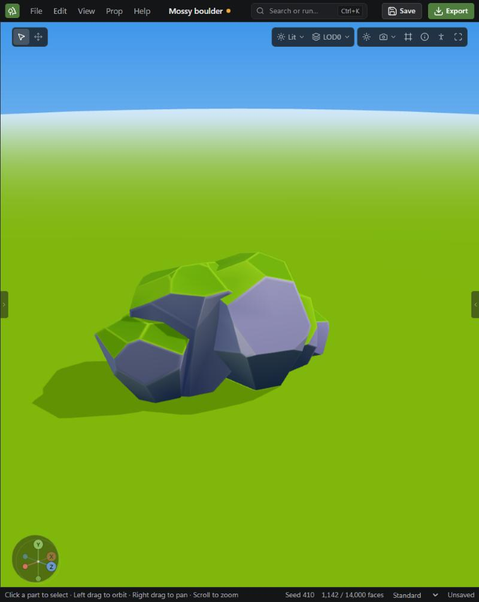 | 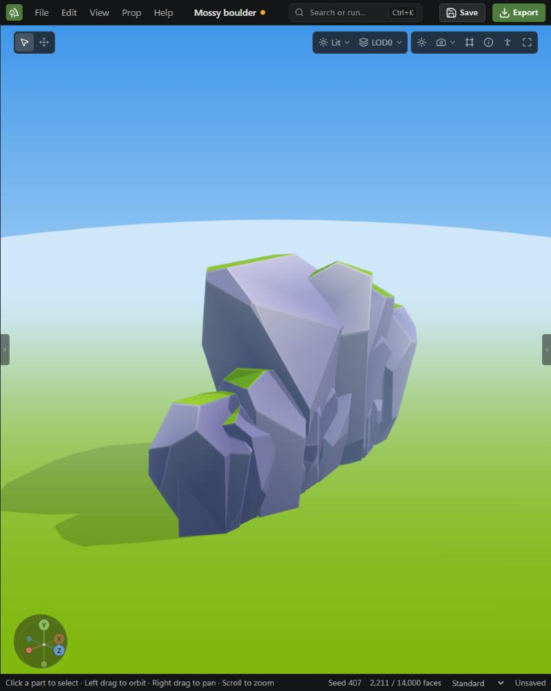 |

Code: `assets/rocks/rock-plan.ts` (recipes and cutting), `rock-mesh.ts` (mesh and paint),
`cut-rock-generator.ts` (controls). What changed from the plan below, after seeing it in the app:

- **Chips.** Random planes often miss what deep cuts left, so a rock had too few faces. Now 30%
  of a chunk's cuts are deep and shape it. The rest each take off a protruding corner, so every
  one lands. This is what moved rocks from gem to stone.
- **No painted sun.** The prototype's value favoured one side, which turned faces away from the
  sun nearly black, and would be wrong on any prop rotated in a game. Value now depends on
  height, how much a face looks up, and its own tone.
- **Nothing faces far downwards**, so stones are planted and never balance on a point.
- **Budget.** A boulder is about 1,000 faces and a cliff about 2,200. The 1,000 limit in stage 1
  was too tight for a mid-range look, so tests hold a boulder under 2,000.
- **The lightest level** tries several amounts of cuts and keeps the nearest to its target, then
  stretches back to full size, so the outline holds.
- **Saved rocks.** The old `rock` generator stays, so they still open. Their Restore to preset
  now gives the new rock of that name, because the preset ids were kept.

**Meadow** is a choice under Settings, Viewport, Backdrop: bright sky, green ground, clear sun and
strong sky light. It doesn't change the default backdrop or anything exported. It doesn't yet stand
other props beside yours, because bushes and grass don't exist.

**Not done:** Rocks haven't been imported into Unreal or Godot. Moss is per face, with no lip over
the edge yet. Cliffs read as one mass from the front but less so from the side.

## The target

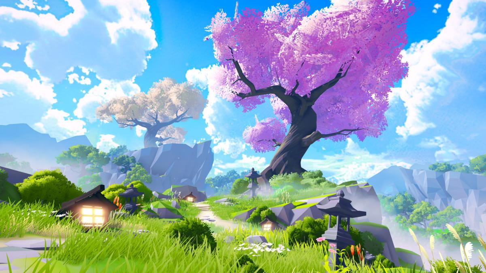

### What the picture actually shows

**Rocks**

- Big flat planes meeting at clear edges. A boulder shows about 15 to 50 planes.
- Larger forms are built from separate chunks, stacked and wedged together. They do not
  read as one surface with dents in it.
- Each plane has its own value, plus a soft gradient across it. This is why they don't
  read as cheap low poly.
- Moss is a decision per plane: a flat bright cap on faces looking up, with a crisp edge.
  It is not a noise mask fading into the stone.
- The colour is cool lavender and periwinkle, not grey or brown. It contrasts with the
  green around it.
- Edges are slightly softened and catch light. This is the difference between the
  "mid-range" you asked for and true low poly.

**Bushes**

- They sit on the ground as solid domes, with no visible trunk or legs.
- No sky shows through them. They read as a soft shaded volume first and as leaves second.
- The gradient is strong: yellow-green on top, near-black green at the base.
- The outline is a fine scallop of many small leaves. It isn't made of big spiky dabs.

**Grass**

- Long, thin, tapered blades in very large numbers.
- Blades in one area lean the same way, as if combed by wind. They don't scatter randomly.
- Each blade runs from dark at the root to yellow-green at the tip.
- Near the camera, individual large blades stand out. Pale dry patches break up the green.
- Mixed in are white daisies, tall red and orange flowers, pink blooms and pampas plumes.

### Colours sampled from the image

Dark, middle and light values from each region. Haze lifts the distant rocks, so treat
those as a guide and not as exact colours.

| Region | Dark | Mid | Light |
|---|---|---|---|
| Rock, hazy shadow side | `#859ad9` | `#95addb` | `#bbc8eb` |
| Moss on rock | `#3a6b00` | `#88b407` | `#a0cf35` |
| Bush, front | `#1a3512` | `#305811` | `#9dba46` |
| Bush, left, lower half | `#1d3c00` | `#2e5100` | `#84af19` |
| Grass, near | `#6a9601` | `#7eae0a` | `#99c226` |
| Lantern (dark stone) | `#212a53` | `#31435b` | `#b3afc6` |

Ramps that worked in the prototype, shadow to highlight:

- **Stone:** `#2e2f62` `#5d60a2` `#9598d4` `#d9daf6`
- **Moss:** `#4f8a08` `#8fbb12` `#c6e640`
- **Bush:** `#1c3f08` `#3d7410` `#7fb31a` `#d3e85c`
- **Grass:** `#3f6e06` `#6da208` `#9ccb1c` `#d6e85e`

The current `STONE_COLOURS` are desaturated grey-greens and browns, so they can't reach
this look whatever the shape is.

## Where we are today

Measured in the app at default settings.

| Preset | Faces | What goes wrong |
|---|---|---|
| Sharp boulder | 5,328 | Set to maximum Facets and still a potato. It has a jagged edge where light meets shadow |
| Cliff face | 3,897 | A blob with horizontal gouges and a torn top |
| Round bush | 2,276 | A flat, lacy crown. It is hollow and doesn't sit like a dome |
| Flowering bush | 4,990 | A small tree: the crown floats on a stem above its own shadow |
| Grass tuft | 1,552 | 14 wide fronds. It reads as a houseplant |

| | | |
|---|---|---|
| 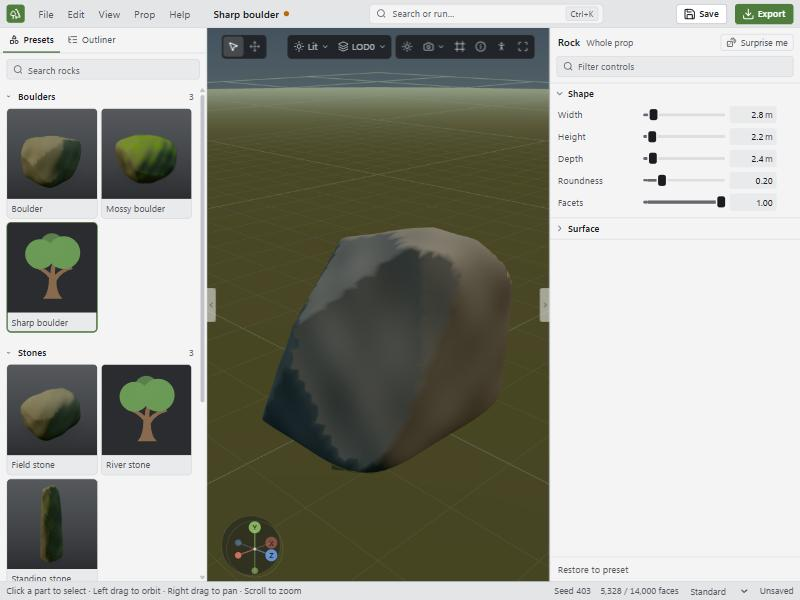 | 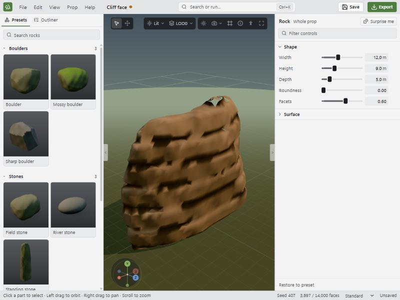 | 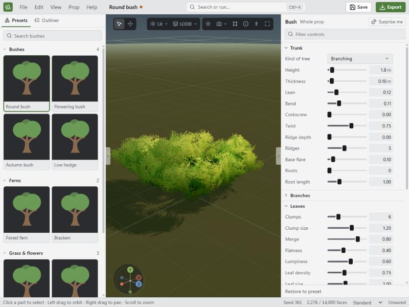 |
| 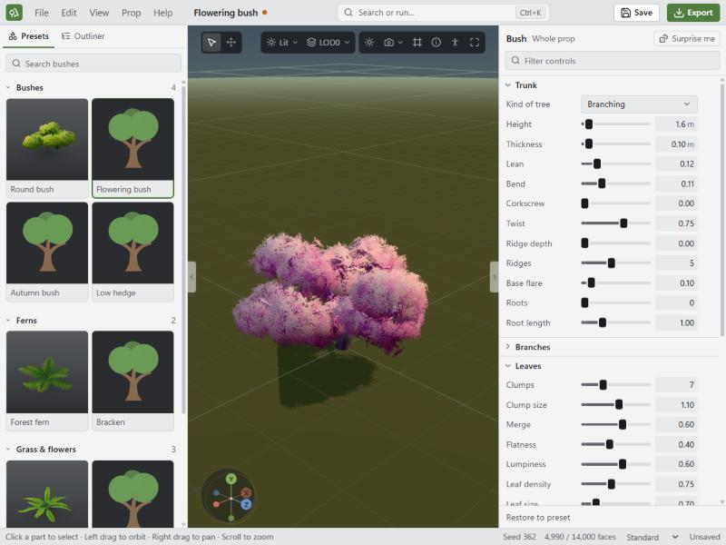 | 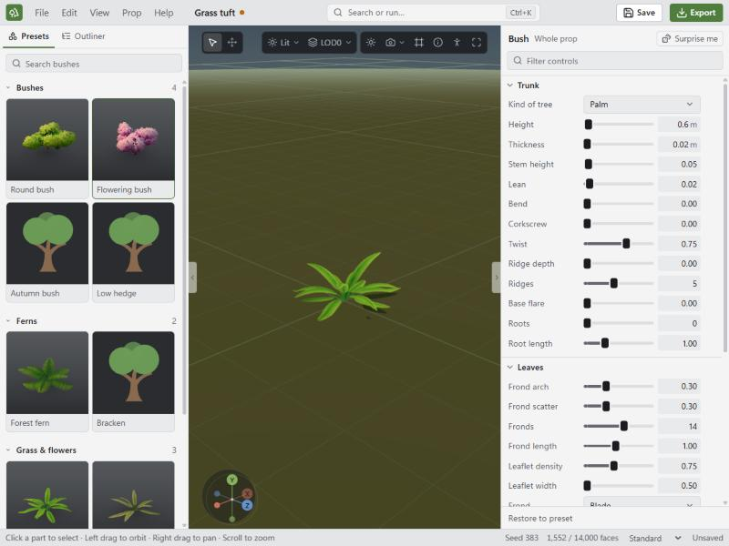 | |

### Why it can't be tuned into place

1. **Rocks: the grid can't hold a hard edge.** `surface-nets.ts` places each vertex at the
   average of where the surface crosses a cell, which rounds every corner. The vertex then
   gets a single smooth normal, so light slides across the edge. In `rock-generator.ts`,
   `faceted = body + (cut - body) * facets` also blends the cuts into a rounded body, so
   nothing is ever truly flat.
2. **Rocks: one surface can't look like stacked chunks.** Sine lumps and sine bands add
   ripples, but the outline stays one blob.
3. **Bushes: the plan is a tree plan.** Fork height, limbs and flatness all assume a crown
   held up by wood. The crown's lobes are not fitted to the ground.
4. **Bushes: there is no core.** `clump-mesh.ts` deliberately avoids a solid core, which
   suits a tree where sky through the crown looks good. On a bush it looks hollow.
5. **Grass: a frond is the wrong unit.** Fronds cost about 100 faces each, so real density
   is out of reach. Reference grass is made of hundreds of blades at about 10 faces each.

## What the research found

Much of the useful technique is shared openly. The specific studio methods mostly are not.

- **Grass.** The best-documented technique comes from *Ghost of Tsushima*, known mainly
  through its GDC talk and community rebuilds. Blades follow a Bezier curve, more vertices
  sit near the tip where it bends, blades are grouped in Voronoi cells, and each clump has
  its own height, lean and pull towards its centre. Colour combines a root-to-tip gradient
  with a clump colour. All of this fits us. The bits we can't copy are the runtime ones,
  because we export a mesh and leave rendering to the engine.
- **Bushes.** Artists agree on the method: an inner shell made opaque so nothing shows
  through, leaf cards around the edge for a fluffy outline, and normals taken from a simple
  smooth shape so it shades as one volume. We already do the normals, and we lack the core.
- **Rocks.** Academic work builds rock from intersected convex cells, and dual contouring
  is the known fix for grids rounding off hard edges. It has well-documented failure cases,
  which is part of why this plan avoids grids altogether.
- **The Witcher 3.** I found no technical breakdown of its grass or bushes. What's confirmed
  is that its foliage was built in SpeedTree and painted onto the map with brushes. The
  lesson I'm drawing is my own reading: richness comes from layering many species at
  different heights, so we need a varied set of plants and not one perfect grass.
- **Genshin Impact and Breath of the Wild.** I found no developer breakdown of their rocks
  or grass, so nothing here should be read as "how those games do it".

The maths below is my own design, informed by these sources and tested in the prototype.

## The maths

### Rocks: cut solids

A rock is a set of **chunks**. Each chunk is a convex solid: everything inside a list of
planes, each with a normal `n` and a distance `d`.

```
inside(p)  when  max over all planes of (n · (p - centre) - d)  <= 0
```

To cut a chunk, make the planes from a size `R` (half width, height and depth):

```
n  = a random direction, with the bias the rock type needs
d  = |R * n| * u      u between 0.72 and 0.98
```

`|R * n|` is how far the box of that size reaches in direction `n`. Multiplying by `u`
slices a little off, and a smaller `u` means a deeper cut. Six more planes bound the size.

**Mesh it exactly, with no grid.** Start each plane as a huge square, then clip it by every
other plane. What remains is that exact face of the solid. Chunks then simply overlap, and
the depth buffer draws the seam between them. Triangles hidden inside another chunk or
below ground are thrown away.

**Why the cost is so low.** Where three faces meet at each corner, a solid with `P` planes
has `E = 3P - 6` edges. Each face gets an inset ring and a fan, which is 3 triangles for
each edge of the face. Each edge borders two faces, so:

```
triangles = 3 * 2E = 18P - 36    before hidden faces are removed
```

| Rock | Planes | Formula | Measured after culling | On the grid |
|---|---|---|---|---|
| Stone | 15 | 234 | 187 | 4,767 (14 planes) |
| Boulder | 48 | 828 | 522 | 22,514 (39 planes) |
| Cliff | 526 | 9,432 | 4,533 | 67,959 (148 planes) |

The grid's cost grows with surface area over cell size squared, however few planes there
are. Here the cost depends only on how many planes we choose, so detail goes where we ask.

**Mid-poly, not low poly.** Four small steps remove the low-poly look:

1. **Soft edges.** Each face gets an inset ring. Inner vertices keep the plane's normal, and
   outer vertices lean towards the average of the faces meeting there. Light rolls over the
   edge with no extra modelling. This is the soft edge in the image below.
2. **Slightly bent planes.** A gentle warp moves every vertex by a function of its position:
   `p += A * sin(f * (p.yzx + phase))`. Shared corners move identically, so no gaps open.
3. **Painted per plane.** Value is a mix of how much the face looks up, its side, its height
   and a random value per plane. The colour follows from that value.

   ```
   value = 0.18 + 0.32 * lift(n) + 0.5 * side(n) + 0.28 * (random - 0.5) + 0.22 * height
   ```
4. **Dark where things meet.** A vertex near another chunk or the ground gets darker, using
   the distance to that chunk, which is simply the formula at the top. It stands in for
   ambient occlusion.

**Moss** is per plane: if `n.y > 0.62`, the face is moss. That gives the reference's crisp
caps for free. A thin lip spilling over the edge can come later.

**Rock types** are recipes for placing chunks, not new maths:

| Type | Chunks | Plane bias |
|---|---|---|
| Stone | 1 | Flattened, wide |
| Boulder | 1 large, 1 to 3 smaller at the base | Any direction, slightly up |
| Outcrop | 3 to 8, stepping up a slope, flat tops | Tops up, for moss |
| Cliff | A large mass, with wedges on its face | Nearly vertical sides, slanted tops |
| Path slab | 1, very flat | Mostly up |

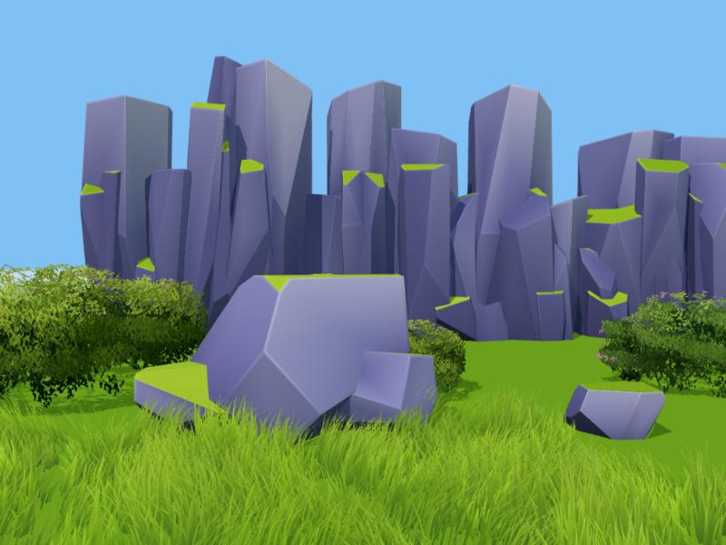

*Prototype of cut solids: boulder 522 triangles, cliff 4,533, stone 187.*

**Still wrong:** the prototype cliff reads as a row of separate columns, where the reference
is one mass with wedges on its face. That needs a large back chunk and a better layout. The
plan treats this as open work.

For comparison, the [grid version](./images/08/proto-grid-rocks.jpg) has stair-steps along
its seams and cost far more.

### Grass: blades in clumps

**One blade** is a quadratic Bezier curve from root `A` through `B` to tip `C`, with a facing
direction `f`, height `H` and lean `L`:

```
B = A + f * L * H * 0.25  + up * H * 0.62
C = A + f * L * H         + up * H * (1 - 0.35 * L)
P(t) = (1-t)^2 * A + 2(1-t)t * B + t^2 * C
width(t) = W * (1 - t^1.6)
```

With `s` segments that ends in a point, a blade has `2s - 1` triangles, doubled to `4s - 2`
by the both-windings approach the trees already use. Those doubled triangles reuse the same
vertices and half are culled, so counts overstate the real cost.

**Clumps give the combed look.** Scatter some clump centres, then give each blade to its
nearest centre, which is a Voronoi cell. Within a clump:

```
root   moves towards the clump centre by "pull"
facing = clump direction + random * spread
height = clump height * random, shrinking towards the patch edge
```

Sharing a direction is what produces the wind-combed areas in the reference. The shrinking
height means a patch has no visible edge when several are placed side by side.

**Normals point mostly up.** A real blade's normal makes thin strips flicker between light
and dark. Bending it towards the sky makes the whole patch light like a soft surface:

```
n = normalize(blade * 0.3 + up + (root - clumpCentre) * 0.4)
```

**Colour:** `ramp(t * 0.82 + (clumpHue - 0.5) * 0.2 + tiny random)`, with `t` running from root
to tip. A root colour near the ground colour makes blades grow out of the terrain.

Grass needs no alpha texture at all. Like palm fronds it can sample the solid middle of the
leaf texture, so it costs no overdraw and shares the material.

| Measured in prototype | Blades | Triangles |
|---|---|---|
| Tuft, 4 segments | 70 | 980 |
| Patch, 3 segments, 1.5 m radius | 900 | 9,000 |

The patch is about 127 blades per square metre, and that density looks right from close up.
It's too heavy to use everywhere, so far grass needs a lighter version (see stage 4).

### Bushes: a dome, a core and leaf cards

**One shape drives everything.** A bush is a smooth union of ellipsoid lobes, one large and
several smaller, plus a small ripple:

```
lobe(p) = (|(p - c) / r| - 1) * min(r)
smin(a, b) = min(a, b) - h^2 * k / 4     h = max(k - |a - b|, 0) / k
F(p) = smin over all lobes + ripple(p)
```

`F = 0` is the outside of the bush. The gradient of `F` gives the rounded normal everywhere,
which replaces the fake clump normals with something more accurate.

**The core is the same shape, moved inwards.** Mesh `F = -inset`, where `inset` is about half
a card's size. Paint it with the **same gradient** as the leaves but a little darker, and use
the **same normals**. A gap between leaves then shows a colour close to what's expected, and
it stops looking like a hole. This single change made the biggest difference to bushes. It
costs about 500 triangles.

**Leaf cards sit on the surface and overlap downwards** like roof tiles. Each card's "down"
follows the slope of the dome, with some randomness:

```
down = normalize( (-n.x * n.y, -(1 - n.y^2), -n.z * n.y) + jitter )
```

**Shading value**, the same recipe the tree clumps use but tied to the ground:

```
value = 0.5 * (n.y * 0.5 + 0.5)  +  0.42 * (y / height)  +  0.22 * min(1, y / (0.3 * height))  -  0.12
```

**How many cards?** Choose a coverage `C`, meaning how many layers of leaf cover a typical
point. With surface area `S`, card half-size `h` and `f` the opaque share of a card:

```
N = C * S / (4 * h^2 * f)
```

This replaces guessing a "density", and it holds a bush's look steady at any size.

**The card image changes.** The current atlas prints round dabs. Bushes need small pointed
leaves, at lower contrast, so the dome reads as a soft volume with detail on top. The new atlas
generates the same way: each leaf is two curves meeting at both ends.

**Flowers** sit just outside the leaves on upper faces, in patches chosen by a smooth noise
mask, so they group into drifts. They use their own small cards in the flower colour.

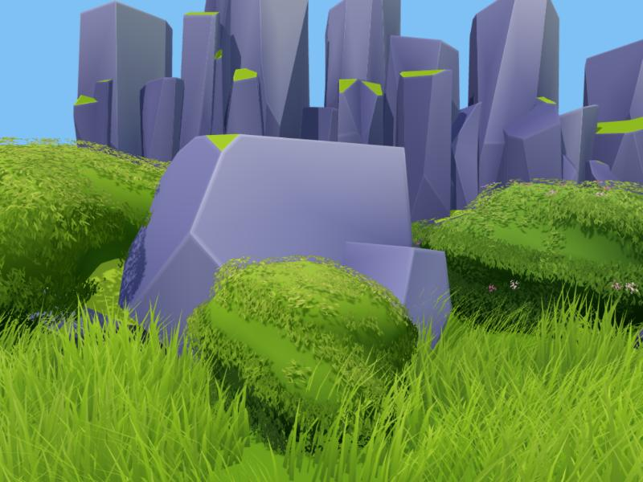

*Prototype: solid core with leaf cards. Bush 3,600 + 500 triangles, small bush 1,628 + 500.*

**Still wrong, both understood:**

1. **Bare bands.** Cards were scattered on a sphere and then pushed onto the shape, which bunches
   them up. Sampling the core mesh by triangle area fixes this, with even spacing by construction.
2. **Flowers disappear.** They were too small and got lost in the leaves. They need to be larger,
   sit further out and have their own shapes.

## How this fits the app

| Area | Change |
|---|---|
| Generators | New prop generators for rock, bush and grass. `prop-generators.ts` is already built for this |
| Saved props | Old rock parameters stop applying. Follow the old palm approach: old generators stay so saved work opens, and only new ones are offered |
| Shared code | Move card placement out of `clump-mesh.ts` so bushes and trees share it |
| Palettes | Add new stone ramps. Rock colour stops depending on tree palettes |
| Wind | `windWeight` swings the outer edge of a prop more, which is wrong for a patch. Grass sway should depend on height along each blade, with a different phase per clump. Rocks stay `still` |
| Levels of detail | Rocks: drop smallest chunks, then the inset rings. Grass: drop blades, then segments, widening those left. Bushes: as clumps do now, with the core always kept |
| Collision | The current shape is a tapered ring pair. Chunks fit it well: one per chunk, up to the 8 allowed. Grass needs none, and a bush gets one dome |
| Budget warnings | Text says "Lower Bark detail". Generalize it for rocks and blades |
| Draw calls | Bush: leaves plus core, 2. Grass: 1. Rock: 1. All within budget |
| Viewport | Dark olive ground and dim sky make these hard to judge. The jagged shadow edge also needs fixing: its bias should scale with prop size |

## The plan

Each stage ends with something you can look at and judge against the reference.

### Stage 0: a place to judge

A "Meadow" view: a bright sky and green ground, with a generated prop shown beside a standard
set of the others. An asset that looks good alone can still fail in a scene, and the reference
is a scene. Also fix the shadow edge.

**Done when:** a screenshot can sit next to the reference for a fair comparison.

### Stage 1: rocks

1. The cut-solid mesher: clipping, hidden-face removal, inset rings, normals and warp.
2. Painting and per-plane moss, with the new stone ramps.
3. Chunk recipes: stone, boulder, outcrop, slab. Then cliff, which needs the most tuning.
4. Controls in plain words: Size, Chunks, Faces, Edge softness, Moss, Palette.
5. Levels, collision and about 12 presets.

**Done when:** a boulder and an outcrop read as the same family as the reference, and a boulder
stays under 1,000 triangles. Cliff needs to read as one mass, not as columns.

### Stage 2: grass

Done before bushes because it's simpler, and it sits in front of everything else in a scene.

1. The blade and clump generator, with blade-based wind.
2. Species: short lawn, long meadow, broad blade, dry tuft.
3. Tuft and tileable patch presets, including a patch that blends at its edges.

**Done when:** a patch placed side by side looks like the foreground of the reference, with no
visible seams or grid.

### Stage 3: bushes

1. The lobe shape, core mesh and even card placement.
2. The new pointed leaf atlas.
3. Bush types as lobe recipes: round, hedge, spreading, tall.
4. Palettes, and presets replacing the current 4 bushes.

**Done when:** a round bush reads as a solid dome grounded in the grass, with no sky through it,
at under 5,000 triangles.

### Stage 4: flowers and the mix

1. Flowering bushes, with flower drifts on the dome.
2. Single plants on stems, each as a small generator: daisy, tulip-like, tall spike, pampas plume.
3. Mixed patches: grass with flowers placed through it.
4. Far versions: a light patch of a few wide blades, which keeps large meadows affordable.

**Done when:** the Meadow view holds up against the foreground of the reference.

## Risks

| Risk | What we'd do |
|---|---|
| Rocks look too low poly next to mid-range trees | Raise plane count and add smaller chunks. Cost stays predictable. The tree bark may also need some planar character |
| Overlapping chunks leave hard seams that look fake | The darkening near other chunks hides most of it. If not, soften with more ring vertices near seams |
| The look relies too much on the viewport | Prototype lighting isn't the app's. Stage 0 checks this early. We must also test in Unreal or Godot, which earlier specs note hasn't been done yet |
| Full grass density is too heavy for engines | Patches are per-instance props and far versions come in stage 4. Check against a real engine during stage 2 |
| Prototype results don't carry over | Its code was quick and its numbers are from one seed each. Tests should hold each budget across seeds |

## Sources

- [Procedural Grass in Ghost of Tsushima, GDC](https://gdcvault.com/play/1027214/Advanced-Graphics-Summit-Procedural-Grass)
- [Unity Grass, a rebuild of that approach](https://cainrademan.github.io/Unity-Grass/)
- [GodotGrass, another rebuild](https://github.com/2Retr0/GodotGrass)
- [Stylized canopy thread: shells, opaque inner layer, projected normals](https://threadreaderapp.com/thread/1582911895149113345.html)
- [Foliage normals add-on](https://www.artstation.com/marketplace/p/npm21/blender-addon-foliage-normals)
- [Discussion of the normals-from-a-blob method](https://answers.unrealengine.com/questions/317173/view.html)
- [Dual Contouring tutorial, and surface nets compared](https://www.boristhebrave.com/2018/04/15/dual-contouring-tutorial/)
- [Infinite Photorealistic Worlds (Infinigen), rocks as distance fields](https://arxiv.org/pdf/2306.09310)
- [Procedural Generation of Rock Piles using Aperiodic Tiling](https://diglib.eg.org/handle/10.2312/CGF.v28i7pp1801-1809)
- [World Building of The Witcher 3, 80.lv](https://80.lv/articles/world-building-of-witcher-3/)
- [SpeedTree in The Witcher 3](https://rpgwatch.com/news/witcher-3--using-speedtree-for-forests-24092.html)
